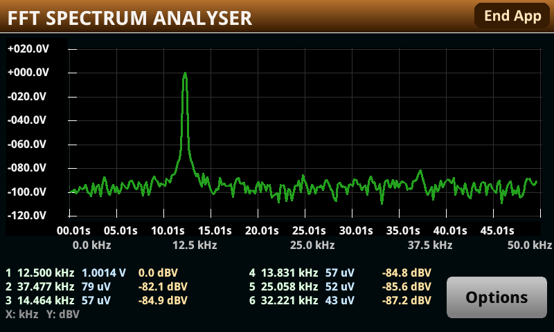

# A spectrum analyser that runs on the DMM6500

A real-time FFT spectrum analyser for the Keithley DMM6500, DAQ6510 and DMM7510, running **entirely
on the instrument** as a TSP app. The digitizer captures, the instrument computes the transform in
Lua, and the firmware's own graph object draws the trace. No host, no PC software.



A bench multimeter is not a spectrum analyser. This one has a 1 MS/s digitizer, a 400 MHz processor
and a touchscreen, which is enough for 195 Hz resolution at 10 frames a second.

`docs/MANUAL.md` is the user manual. Start there to operate it; read on for how it works.

## What it does

- **Digitizes** up to 1 MS/s, 512 samples a frame, into a reading buffer.
- **Transforms** with a real-input radix-2 FFT in Lua 5.0.2. The window, the bit-reversal permutation
  and every twiddle factor are precomputed once. 256 bins.
- **Plots** through `display.OBJ_GRAPH`, one call a frame rather than one a point, which brings axes,
  grid, labels and auto-scaling with it.
- **Finds six peaks** to sub-bin accuracy, correcting both the frequency and the scalloping loss.
- **Offers four windows**, Kaiser with six betas, and reads peaks exactly for each.

The **stop** frequency chooses the sample rate — the smallest exact rate at or above twice it — so a
narrower span also gives finer resolution. The **start** frequency windows the display.

## Choosing a window

| | peak sidelobe | scalloping loss | -20 dB peak width | skirt swing |
|---|---|---|---|---|
| **Hann** (default) | -31.5 dB | -1.42 dB | 3-4 bins | 32.8 dB |
| **Blackman** | -58.1 | -1.09 | 3-4 | 15.3 |
| **Blk-Harris** | -92.0 | -0.82 | 4-5 | 8.2 |
| **Kaiser** β=4 | -30.0 | -2.06 | 2-3 | 7.6 |
| β=6 | -43.8 | -1.50 | 3-4 | 7.6 |
| β=9 | -66.3 | -1.06 | 4-5 | 13.3 |
| β=12 | -90.0 | -0.82 | 4-5 | 8.1 |
| β=15 | -114.0 | -0.67 | 5-6 | 6.1 |
| β=18 | -138.6 | -0.56 | 5-6 | 4.9 |

`tools/window_check.lua` measures every figure from the window the instrument builds. **Skirt swing**
is the one that is not a textbook number: how much the level two bins out changes between a tone on a
bin centre and one half a bin off. On a centre the DFT samples the window transform at its own nulls
and the skirts vanish, so the peak draws narrower — Hann swings 33 dB, which is why a tone at exactly
25 kHz looks sharper than the same tone at 24 kHz. Kaiser at β=15 or 18 cuts that to 5-6 dB and
doubles the peak width. `docs/MANUAL.md` explains the effect for an operator.

**The peak estimate is exact for every window.** `fft_init` samples the window's own transform into a
61-point table, inverts the offset-to-ratio curve from it, and reads the scalloping correction from
the same table, so the estimator is derived from the window in use rather than fitted to one and
approximated for the rest. Worst case over 83 sub-bin offsets and all nine settings: **4.0e-6 bins of
frequency error and 0.0035 dB of amplitude error**, both at Kaiser β=4. `tools/test_tsp.lua` pins
them at 1e-5 bins and 0.008 dB, and proves the sweep failable by feeding one window's data to
another's tables.

Rectangular and Hamming are absent. Rectangular's transform nulls one bin from the peak, which leaves
the three-bin estimate ill-conditioned; Kaiser β=6 covers Hamming to within a dB.

Mixed signals are where the choice earns its keep. A weak tone 40 dB down and 5 bins from a strong
one reads -38.5 dBV under Hann, whose own sidelobes add in, and -39.8 under Blackman-Harris. Kaiser
β=4 misses it entirely: -30 dB sidelobes bury a -40 dB tone.

## Layout

```
FFT_Spectrum.tspa        the packaged app, installable from a USB key
tsp/fft_core.tsp         the transform: windows, bit reversal, twiddles, butterflies, peak estimate
tsp/spectrum_app.tsp     the options form and the run loop
tsp/spectrum_graph.tsp   the graph, its scaling, and the frequency axis
tsp/spectrum_ui.tsp      the loading cover and peak finding
tools/window_check.lua   what the peak estimator achieves, per window, against known tones
tools/                   packaging, linting, screen capture, test harness
docs/MANUAL.md           the user manual
docs/PERFORMANCE.md      where the frame time goes, and what is left to win
docs/pixel-drawing.pdf   why the graph object beat line objects and setpixel
```

## Building and installing

```sh
python3 tools/package_tspa.py                           # -> FFT_Spectrum.tspa, gated
~/tmp/base/out/lua502/bin/lua tools/test_tsp.lua        # the offline suite
~/tmp/base/out/lua502/bin/lua tools/window_check.lua    # per-window accuracy
python3 tools/lint_tsp.py tsp/*.tsp                     # Lua 5.0.2 syntax gate
```

Copy `FFT_Spectrum.tspa` to a USB key and install it from **MENU > Manage Apps**.

**Run the suite under Lua 5.0.2, never the `lua` on `$PATH`.** The instrument is 5.0.2; later
versions accept hex literals, `#`, string methods and `string.match`, none of which it takes. A parse
error anywhere in the archive leaves `fftsa` nil, so every call raises `-286` on the panel.
`package_tspa.py` gates itself against that: it runs the linter, then compiles the *assembled* script
with 5.0.2's own compiler, before writing anything. A missing 5.0.2 compiler is a refusal, not a skip.

## Notes on the instrument

Two measured facts shape the whole design.

**The display runs in another task on the same core, and only while Lua is blocked.** A separate GUI
task draws, not the second PowerPC: the start-up code creates it locally and the channel the display
API talks over is in-process. Sharing the one core with the interpreter, it is scheduled only when
the Lua task blocks — so a Lua frame rate means nothing by itself. A frame loop with a 5 ms yield
measures 35.6 Hz in Lua while dropping display messages and updating the glass three times a second.
Every frame therefore blocks once, deliberately, for the paint.

That also fixes the frame rate. A timer tick arriving mid-frame is dropped rather than queued, and
the shortest period the firmware accepts is 0.05 s, so the displayed rate is quantised to
`1/(0.05 × ceil(frame/0.05))` — 20, 10, 6.67 fps and nothing between. Getting a frame under 50 ms
doubles the rate; shaving it from 81 ms to 55 ms buys nothing.

**The interpreter is the bottleneck, not the arithmetic.** A Lua table read costs about 1.4 µs and an
arithmetic operation about 1.2 µs — some 480 cycles at 400 MHz for one multiply whose floating-point
part is 3 to 5 cycles. Everything in `fft_core.tsp` that looks like premature optimisation is there
because the inner loop is table-access bound. `docs/PERFORMANCE.md` has the cost model.

## Licence

MIT. See `LICENSE`.

Keithley's manuals and the processor reference manuals this work was done against are **not** in the
repository — they are vendor copyright. Everything measured from them is quoted with its source
named.
