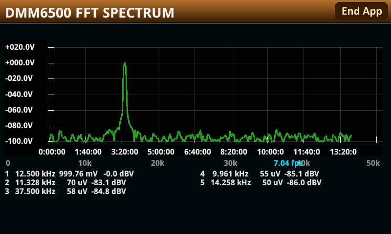

# A spectrum analyser that runs on the DMM6500

A real-time FFT spectrum analyser for the Keithley DMM6500, DAQ6510 and DMM7510, running **entirely
on the instrument** as a TSP app. No host, no PC software: the digitizer captures, the instrument
computes the transform in Lua, and the firmware's own graph object draws the trace. Touch the front
panel to change the span.

**Supported hardware:** DMM6500, DAQ6510, DMM7510 — all three tested and working. The DMM6500 and
DAQ6510 share the same boards. The DMM7510 has a better digitizer and analog front end, so it gives
the cleanest spectrum of the three. All of them reach the digitizer as `dmm.digitize`, the only
instrument namespace this app uses.



The DMM6500 is a bench multimeter, not a spectrum analyser. It does have a 1 MS/s digitizer, a
400 MHz processor and a touchscreen, and that turns out to be enough for a usable instrument at
around 10 frames a second at 195 Hz resolution.

## What it does

- **Digitizes** up to 1 MS/s into a reading buffer, 512 samples a frame.
- **Transforms** with a real-input radix-2 FFT in Lua 5.0.2, with the window, the bit-reversal
  permutation and every twiddle factor precomputed once. 256 bins.
- **Plots** through the instrument's own `display.OBJ_GRAPH`, which costs one call per frame rather
  than one per point, and brings axes, grid, labels and auto-scaling with it.
- **Finds peaks** to sub-bin accuracy. A tone almost never lands on a bin centre, and a single-bin
  reading pays for it twice -- the frequency is quantised to the bin grid and the amplitude suffers
  scalloping loss, up to -1.42 dB with a Hann window. Both come back from the peak bin and its two
  neighbours. Verified on hardware: a 12.000 kHz 1.000 V tone at 195.3 Hz bin width reads
  11.914 kHz / 0.883 V from the peak bin alone, and 11999.8 Hz / 1.0016 V from the three-bin
  estimate.
- **Five analysis windows**, with the peak estimate exact for each -- see below.

The options form sets the span like a real analyser would: the **stop** frequency chooses the sample
rate (`fs` = the smallest exact rate at or above twice it, so a narrower span also gives finer
resolution), and the **start** frequency restricts what is displayed.

## Choosing a window

| | peak sidelobe | scalloping loss | -20 dB peak width | skirt swing |
|---|---|---|---|---|
| **Hann** (default) | -31.5 dB | -1.42 dB | 3-4 bins | 32.8 dB |
| **Hamming** | -42.7 | -1.75 | 3-4 | 11.7 |
| **Blackman** | -58.1 | -1.09 | 3-4 | 15.3 |
| **Blk-Harris** | -92.0 | -0.82 | 4-5 | 8.2 |
| **Kaiser** β=4 | -30.0 | -2.06 | 2-3 | 7.6 |
| β=6 | -43.8 | -1.50 | 3-4 | 7.6 |
| β=9 | -66.3 | -1.06 | 4-5 | 13.3 |
| β=12 | -90.0 | -0.82 | 4-5 | 8.1 |
| β=15 | -114.0 | -0.67 | 5-6 | 6.1 |
| β=18 | -138.6 | -0.56 | 5-6 | 4.9 |

Every figure is measured from the window the instrument actually builds, by
`tools/window_check.lua`. **Skirt swing** is the one that is not a textbook number: it is how much
the level two bins from the peak changes between a tone sitting on a bin centre and one sitting half
a bin off. On a centre the DFT samples the window transform at its own nulls and the skirts vanish,
so the peak draws visibly narrower than its neighbours do — Hann swings 33 dB, which is what makes
a tone at exactly 25 kHz look sharper than the same tone at 24 kHz. Kaiser at β=15 or 18 brings that
down to 5-6 dB, at the cost of a peak twice as wide.

**The peak estimate is exact for every one of them**, and that is not the usual three-bin story. The
window's own transform is sampled at build time into a 61-point table, the offset-to-ratio curve is
inverted from it, and the scalloping correction is read from the same table — so the estimator is
derived from the window in use rather than fitted to one window and approximated for the rest.
Measured worst case over 83 sub-bin offsets: **4.3e-6 bins of frequency error and 0.0035 dB of
amplitude error**, for all ten settings. `tools/test_tsp.lua` pins both.

Rectangular is deliberately absent: its transform has a null one bin from the peak, which leaves
three-bin interpolation ill-conditioned, so the peak readings would be wrong in a way the trace does
not show.

Mixed signals are where the choice earns its keep. A weak tone 40 dB down and 5 bins from a strong
one reads -38.5 dBV under Hann (its own sidelobes add in) and -39.8 under Blackman-Harris; Kaiser at
β=4 misses it entirely, because -30 dB sidelobes bury a -40 dB tone. There is no single best window,
which is why the choice is the answer.

## Layout

```
FFT_Spectrum.tspa        the packaged app, installable from a USB key
tsp/fft_core.tsp         the transform: windows, bit reversal, twiddles, butterflies, peak estimate
tsp/spectrum_app.tsp     the options form and the run loop
tsp/spectrum_graph.tsp   the graph, its scaling, and the frequency axis
tsp/spectrum_ui.tsp      the loading cover and peak finding
tools/                   host-side helpers -- packaging, linting, screen capture, test harness
tools/window_check.lua   what the peak estimator achieves, per window, against known tones
docs/PERFORMANCE.md      where the frame time goes, measured, and what is left to win
docs/pixel-drawing.pdf   the three render paths that were benchmarked, and why the graph won
```

## Building and installing

```sh
python3 tools/package_tspa.py          # -> FFT_Spectrum.tspa, gated (see below)
~/tmp/base/out/lua502/bin/lua tools/test_tsp.lua        # the offline suite, 186 tests
~/tmp/base/out/lua502/bin/lua tools/window_check.lua    # per-window accuracy
python3 tools/lint_tsp.py tsp/*.tsp    # Lua 5.0.2 syntax gate
```

**Run the suite under Lua 5.0.2, never the `lua` on `$PATH`.** The instrument is 5.0.2 and later
versions accept a great deal it does not — hex literals, `#`, string methods, `string.match`. A
parse error anywhere in the archive leaves `fftsa` nil, so every call then raises `-286` on the
panel. `package_tspa.py` therefore gates itself: it runs the linter and compiles the *assembled*
script with 5.0.2's own compiler before writing anything, and a missing 5.0.2 compiler is a refusal
rather than a skip.

Copy `FFT_Spectrum.tspa` to a USB key, plug it into the instrument, and install it from
**MENU > Manage Apps**.

## Notes on the instrument

Two things shaped the whole design, and both are measured rather than assumed.

**The display runs in another task on the same core, and only while Lua is blocked.** The drawing is
done by a separate GUI task, not by the second PowerPC: the start-up code creates it locally, and the
"channel" the display API talks over is in-process. Because it shares the one core with the
interpreter, it is scheduled only when the Lua task blocks -- so a Lua frame rate means nothing on
its own. Measured: a frame loop with a 5 ms yield ran at 35.6 Hz in Lua while dropping display
messages and updating the glass about three times a second. Every frame must therefore block once,
deliberately, for the paint.

That also fixes what the frame rate is. A timer tick arriving mid-frame is dropped rather than
queued, and the shortest period the firmware accepts is 0.05 s, so the displayed rate is quantised to
`1/(0.05 × ceil(frame/0.05))` -- 20, 10, 6.67 fps and nothing between. Getting the frame under 50 ms
is worth double; shaving it from 81 ms to 55 ms is worth nothing at all.

Three render paths were benchmarked -- the built-in graph object, N line objects, and the
undocumented `display.setpixel` -- and the graph won by an order of magnitude.
`docs/pixel-drawing.pdf` has the numbers.

**The arithmetic is not the bottleneck; the interpreter is.** A Lua table read costs about 1.4 µs and
an arithmetic operation about 1.2 µs, which at 400 MHz is some 480 cycles for one multiply whose
floating-point part is 3 to 5 cycles. Everything in `fft_core.tsp` that looks like premature
optimisation -- the precomputed tables, the aggressive local caching, the specialised first stage --
is there because the inner loop is table-access bound. `docs/PERFORMANCE.md` has the full cost model
and the remaining levers.

## Licence

MIT. See `LICENSE`.

Keithley's manuals and the processor reference manuals this work was done against are **not** in the
repository -- they are vendor copyright. Everything measured from them is quoted with its source
named.
