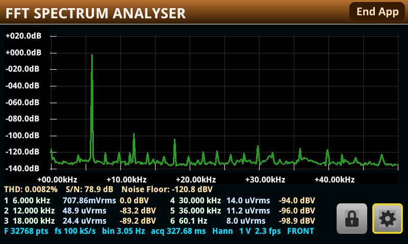
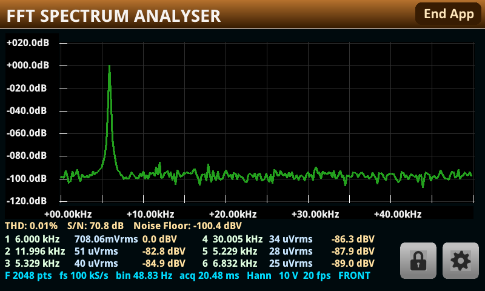

# A spectrum analyser that runs on the Keithley DMM6500, DMM7510, and DAQ6510

A real-time FFT spectrum analyser for the Keithley DMM6500, DAQ6510 and DMM7510, running **entirely
on the instrument** as a TSP app. The digitizer captures, the native FFT computes the transform,
and the firmware's own graph object draws the trace. No host, no PC software.

The 6 kHz tone sits at **0.0 dBV**. The peak table resolves the second harmonic at **12 kHz**
(−83.2 dBV), the third at **18 kHz** (−89.2 dBV), the fifth at **30 kHz** (−94.0 dBV), and the
sixth at **36 kHz** (−96.0 dBV). The separate 60.1 Hz peak is not a harmonic of the test tone.
The display reports **0.0082% THD**, **78.9 dB S/N**, and a **−120.8 dBV** noise floor.

`docs/MANUAL.md` is the user manual. Start there to operate it; read on for how it works.

## The F indicator, and what to do if it does not appear

The bottom line of the spectrum screen begins with **`F`** once the app is drawing by its fast
path — writing pixel records straight into the firmware's graph ring instead of appending
readings one at a time. That roughly doubles the frame rate. It appears within about three
seconds of launch and then stays up; `F2`, `F3` and so on count the times it has had to
re-acquire, which a span or sample-count change will do.

**If no `F` appears within five seconds of starting the app**, the fast path has not found what
it needs on your instrument and the app is running on the slower append path — correct, just
about half the rate. Please help us fix it: go to **Options → About**, page through all four
pages, photograph each, and post them to the
EEVblog thread [TSP and Lua scripts for modern Keithley DMMs, SMUs etc](https://www.eevblog.com/forum/testgear/tsp-and-lua-scripts-for-modern-keithley-dmms-smus-etc/).
Those pages carry the addresses the app looked at and the reason it stopped, which is what
makes the difference diagnosable without the instrument in front of us. Say which model and
firmware version you are on — the About page's first line has both.

**If the Options key is slow to respond, something is talking to the instrument.** Front-panel
keys are dispatched by the display task, and a LAN or USB session — a script, a probe, anything
holding the control socket — stops that dispatch while it is connected, so presses queue instead
of landing. Close the session and the key is immediate again. On its own the app stays
responsive at every sample count.

## What it does

- **Digitizes** up to 1 MS/s, with selectable 1,024 to 32,768 samples per frame (default 2,048).
- **Transforms** with a real-input radix-2 FFT. The window, the bit-reversal permutation and every
  twiddle factor are precomputed when settings are applied.
- **Plots** through `display.OBJ_GRAPH`, one buffer refill a frame and no graph call in a frame
  nobody has touched, which brings axes, grid, labels and auto-scaling with it. The firmware labels both axes in real units --
  kHz across, from binding X to the reading's extra field rather than its timestamp, and dB down,
  from a two-character custom buffer unit. The trace is a fixed **255 columns** at every
  sample count, each carrying the **maximum of the bins it covers**, so a narrow tone always reaches
  it however many bins the span holds.
- **Finds six peaks** to sub-bin accuracy, correcting both the frequency and the scalloping loss.
  The peak table shows Vrms and graph-referenced dBV.
- **Offers four windows**, Kaiser with six betas, and reads peaks exactly for each.
- **Settles every gesture.** The firmware's graph pans and zooms on touch and will not be told not to,
  so a brushed screen slides the trace off its axes. The dB axis always goes back — there is no
  setting behind it. The **padlock** decides what a sideways drag means: closed, the frequency axis
  snaps back to the span in force; open, the span follows the axis, so dragging or pinching
  **retunes** the analyser to the range you brought into view, Options fields and all, clamped
  through the same function the form uses.  The cog beside the padlock opens Options.

More samples give finer bins without reducing bandwidth: 16,384 samples at 100 kS/s give
6.10 Hz spacing. Larger sizes cost update rate. `docs/PERFORMANCE.md` has every size measured.

At 2,048 samples the app trades frequency resolution for faster updates. This view of a 6 kHz
tone shows 48.83 Hz bins and 20 fps at 100 kS/s:

The noise floor is a per-bin level and falls as the bins narrow. S/N compares the signal with
integrated noise across the span, not with the per-bin floor.

**The plot floor follows the instrument, input range, and sample count.** The default is −120 dBV.
On the 1 V and 0.1 V ranges, it reaches −140 dBV on the DMM7510 and at 16,384 samples or more on
the DMM6500. The axis, trace clamp, and peak table share the same floor.

The THD figure carries **two decimals below 8,192 samples, three at 8,192 and four at 16,384**, gated
on the sample count the transform actually committed rather than on the form's. Each doubling halves
the bin width, so each digit is only offered on a record long enough to earn it.

## Choosing a window

| | peak sidelobe | scalloping loss | -20 dB peak width | skirt swing |
|---|---|---|---|---|
| **Hann** (default) | -31.5 dB | -1.42 dB | 3-4 bins | 49.8 dB |
| **Blackman** | -58.1 | -1.09 | 3-4 | 10.8 |
| **Blk-Harris** | -92.0 | -0.82 | 4-5 | 7.2 |
| **Kaiser** β=4 | -30.0 | -2.06 | 2-3 | 3.9 |
| β=6 | -43.8 | -1.50 | 3-4 | 21.9 |
| β=9 | -66.3 | -1.06 | 4-5 | 10.1 |
| β=12 | -90.0 | -0.82 | 4-5 | 7.2 |
| β=15 | -114.0 | -0.67 | 5-6 | 5.6 |
| β=18 | -138.6 | -0.56 | 5-6 | 4.7 |

**Skirt swing** is the one that is not a textbook number: the level at the second bin from the peak, 
on a bin centre against half a bin off. On a centre that bin sits 2.0 bins from the tone; half a bin off, 
the nearer of the two sits 1.5 bins away — so the figure is how far the window's transform rises between 
those two offsets, and it is what makes a tone at exactly 25 kHz look sharper than the same tone at
24 kHz. Hann swings 50 dB, because its transform nulls at 2 bins exactly. Kaiser at β=15 or 18 cuts
that to 5 dB and doubles the peak width; β=6 is the other extreme at 22 dB, its main lobe ending at
2.16 bins. `docs/MANUAL.md` explains the effect for an operator.

**The peak estimate is exact for every window, in the middle of the spectrum.** `fft_init` samples
the window's own transform into a 61-point table, inverts the offset-to-ratio curve from it, and reads
the scalloping correction from the same table, so the estimator is derived from the window in use
rather than fitted to one and approximated for the rest. Worst case over 83 sub-bin offsets and all
nine settings: **4.0e-6 bins of frequency error and 0.0035 dB of amplitude error**, both at Kaiser
β=4. 

## Licence

MIT. See `LICENSE`.
