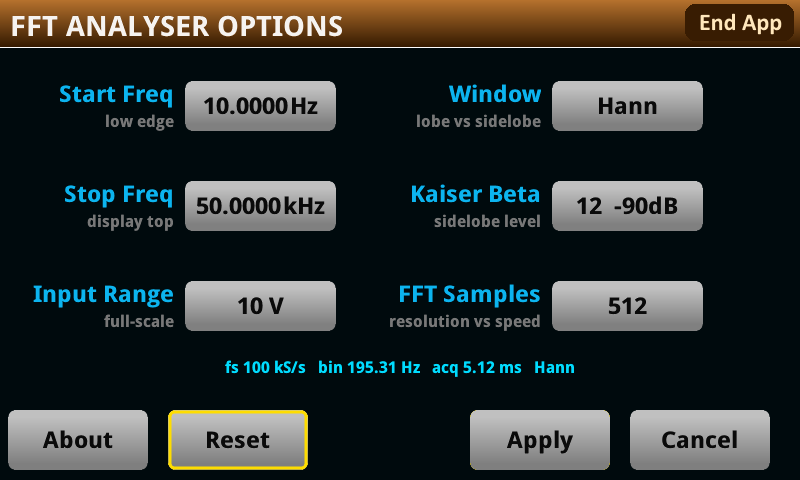

# FFT Spectrum Analyser

Runs entirely on the instrument: the digitizer captures, the instrument computes the transform, the
firmware's own graph object draws the trace. DMM6500, DAQ6510 and DMM7510.

Install `FFT_Spectrum.tspa` from a USB key under **MENU > Manage Apps**. **End App** frees every
screen and buffer the app made.

## The spectrum screen


+20 to −120 dBV against frequency. 512 samples a frame, 256 bins, about 10 frames a second.

**Two rows of numbers sit under the plot. Read the lower one.** The graph object's X axis is
hardwired to time, so the app writes each bin's frequency into the timestamp and the firmware labels
it in seconds — one label-second is one kilohertz. The app prints its own row, in real units,
beneath. The dB numbers down the left edge are the firmware's and are correct as written; ignore the
`V` suffix.

Six peaks, strongest first, in two columns:

```
1  21.100 kHz   4.5122 V   13.1 dBV
```

In the capture, peak 2 falls at exactly twice peak 1 and 1.0 dB below it. Peaks 3 to 6 are noise,
74 dB down.

## Options



| Field | |
|---|---|
| Start Freq | Low edge of the display. Floor 10 Hz, because bin 1 is DC. |
| Stop Freq | Top of the display, 2 kHz to 500 kHz. Zooming in does not change the sample rate; widening past 50 kHz raises it. |
| Input Range | 0.1, 1 or 10 V full scale. |
| Window | Hann, Blackman, Blk-Harris or Kaiser. |
| Kaiser Beta | Sidelobe level, −30 to −139 dB. Inert for the other three windows. |

The line under the fields reads back what the instrument settled on. The sample rate snaps to one the
hardware can produce, so it is rarely the number you asked for.

Apply rebuilds the window and its tables — about a third of a second, behind the loading screen.

## Windows

A window tapers the 512 samples to zero at each end. Without one, the ends of the record form a step
that smears every tone across the whole spectrum. The shape of the taper sets what you can see, and
every shape trades the same two things: a **narrow main lobe** resolves two close tones, **low
sidelobes** reveal a weak tone beside a strong one. None gives both.

| | peak sidelobe | scalloping loss | peak width | skirt swing |
|---|---|---|---|---|
| **Hann** (default) | −31.5 dB | −1.42 dB | 3–4 bins | 32.8 dB |
| **Blackman** | −58.1 | −1.09 | 3–4 | 15.3 |
| **Blk-Harris** | −92.0 | −0.82 | 4–5 | 8.2 |
| **Kaiser** β=4 | −30.0 | −2.06 | 2–3 | 7.6 |
| β=6 | −43.8 | −1.50 | 3–4 | 7.6 |
| β=9 | −66.3 | −1.06 | 4–5 | 13.3 |
| β=12 | −90.0 | −0.82 | 4–5 | 8.1 |
| β=15 | −114.0 | −0.67 | 5–6 | 6.1 |
| β=18 | −138.6 | −0.56 | 5–6 | 4.9 |

**Hann** for general work: it resolves well and its peaks are narrow. **Blackman** or **Blk-Harris**
to find a weak tone near a strong one. **Kaiser** to choose the sidelobe floor directly — β buys
about 7 dB per unit. β=6 matches Hann's resolution with 12 dB lower sidelobes; β=18 buries sidelobes
at −139 dB and makes every peak six bins wide.

Kaiser β=4 has the narrowest main lobe here and the worst sidelobes. A tone 40 dB down and five bins
from a strong one vanishes under them.

## Why a peak narrows at some frequencies

Tune a generator slowly and the peak changes width. At some frequencies it stands up as a clean
spike; a few hundred hertz away it grows skirts. The signal has not changed.

The bins are what moved. The DFT samples the window's transform at whole-bin offsets from the tone,
and the Hann transform is **zero at every whole-bin offset past the first**. A tone sitting exactly
on a bin centre therefore puts all its neighbours in those zeros: three bins carry the tone and the
rest carry nothing. Move the tone half a bin and the neighbours land on the sidelobe envelope
instead, which is far from zero, and the skirts appear.

With Hann the level two bins out swings **32.8 dB** between the two cases. At 100 kS/s and N=512 the
bins are 195.3 Hz apart, so 25.000 kHz is bin 128 exactly and draws the spike; 24.9 kHz is not and
draws the skirts.

**The narrow peak is the truthful one.** The skirts are leakage, not signal. The amplitude in the
peak table is right in both cases.

If the changing width distracts, use **Kaiser at β=15 or β=18**. Their transforms do not null at
whole-bin offsets, so the skirt stays put as the tone moves — 5 to 6 dB of swing instead of 33, for
a peak about twice as wide.

## Aliasing: a peak can be real and still be at the wrong frequency

There is no anti-alias filter in front of the digitizer. Anything above half the sample rate folds
back into the display, at full amplitude, looking exactly like a tone that is there.

Measured: a pure 21.1 kHz sine, with the sample rate chosen from a 0 to 7 kHz span, drew one 4.5135 V
peak at **1.100 kHz** — 21100 reduced mod 20000. The amplitude was right to four digits. Nothing on
the screen said the frequency was not.

That is why zooming in no longer lowers the sample rate. The span selects which bins are drawn and
leaves acquisition alone, so a tone outside the view is excluded rather than folded into it.

**Folding above 50 kHz remains**, because it is the missing filter rather than the rate. At the
default span a 63 kHz tone appears at 37 kHz and an 84 kHz tone at 16 kHz. Two ways to tell an alias
from a tone: widen the span, and a real tone stays put while an alias moves; or change the signal and
watch which peak follows.

## The peak table is more accurate than the trace

A tone almost never lands on a bin centre, and reading the tallest bin pays for that twice: the
frequency is quantised to the bin grid, up to 98 Hz out at 195.3 Hz bins, and the amplitude reads low
by the scalloping loss, up to 1.42 dB with Hann.

The table recovers both from the tallest bin and its two neighbours. On hardware, a 12.000 kHz
1.000 V tone reads 11.914 kHz / 0.883 V from the tallest bin alone and 11999.8 Hz / 1.0016 V in the
table.

So the apex of the trace can sit 1.4 dB below the number printed under it. The number is right. Over
83 sub-bin offsets and every window the worst case is 4.0e-6 bins and 0.0035 dB; the estimator reads
the window's own transform, so it carries no per-window approximation.

## Limits

- **Bin width is the sample rate over 512**, and the sample rate is 100 kS/s for any span up to
  50 kHz — so bins are 195.3 Hz and **zooming in does not make them finer**. Two tones closer than
  195.3 Hz merge, and no setting separates them.
- **A span wider than 50 kHz raises the rate** and coarsens the bins with it: 200 kS/s to 100 kHz
  (390.6 Hz bins), 500 kS/s to 250 kHz (976.6 Hz), 1 MS/s to 500 kHz (1953 Hz). 500 kHz is the
  highest tone the instrument can show.
- **About 10 frames a second.** The firmware's shortest timer period is 0.05 s and a tick arriving
  mid-frame is dropped, so the rate is quantised to 20, 10, 6.67 and 5 fps.
- **No rectangular or flat-top window.** Rectangular nulls one bin from the peak, which makes the
  three-bin estimate unusable; flat-top is seven bins wide.
- **No averaging and no peak hold.** Each frame is one capture.

## Troubleshooting

| Symptom | Cause |
|---|---|
| Trace pinned at the bottom | Range too high, or no signal. |
| Peak flat-topped at +20 dBV | Over range. |
| Trace frozen, peaks static | A capture is returning short. The app holds the last good frame rather than show a false spectrum. |
| Text where `X: kHz  Y: dBV` belongs | A failure message. It clears at the next span change. |
| Peak width changes as you tune | Expected. See above. |
