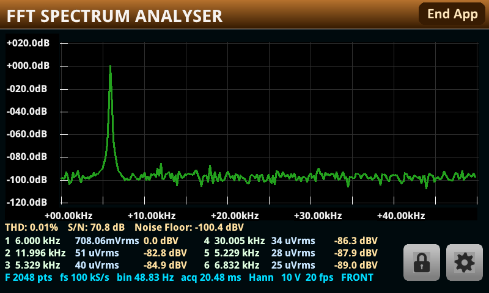
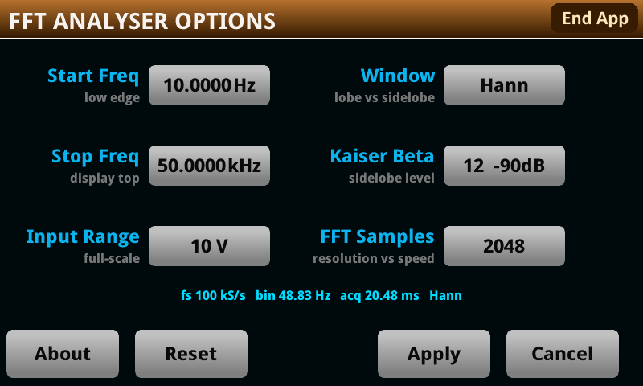
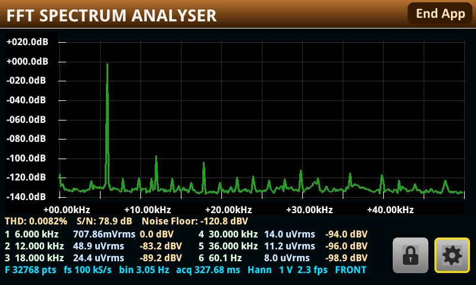

# FFT Spectrum Analyser

Runs entirely on the instrument: the digitizer captures, the instrument computes the transform, the
firmware's own graph object draws the trace. DMM6500, DAQ6510 and DMM7510.

Install `FFT_Spectrum.tspa` from a USB key under **MENU > Manage Apps**. **End App** frees the app's
screens and graph buffers. Selecting a different measurement or digitize function with the
front-panel **FUNCTION** key also exits the analyser and leaves that function selected. From the
live spectrum, the physical **EXIT** key exits the analyser too.

## The spectrum screen



The graph spans +20 to −120 dBV by default and extends to −140 dBV in the low-range settings
described below. At the default 2,048 samples and 100 kS/s, bins are 48.83 Hz wide. The screenshot
shows the fast path at 20 fps.
Options offers larger records for finer bin spacing at a slower update rate.

### The `F` at the start of the bottom line

The bottom line reads `F  2048 pts  …` once the app is drawing by its **fast path**. Instead of
appending 510 readings one at a time for the firmware's display task to copy, it writes the
pixel records straight into the task's own ring in a single operation, and asks for one repaint.
That is about twice the frame rate of appending under comparable settings.

It should appear **within about three seconds of launch**, and then stay. A number after it --
`F2`, `F3` -- counts how many times the path has had to re-acquire since the line last changed.
Changing the span or the sample count does that, and so does anything that makes the firmware
rebuild its trace: the count going up by one now and then is normal and costs a few frames each
time, during which the app falls back to appending.

**If no `F` appears within five seconds**, the fast path has not found what it needs on your
instrument. Nothing is wrong with the measurements -- the append path is correct and shows the
same spectrum -- but you are getting about half the frame rate, and we would like to fix it.

Go to **Options → About** and page through with **PgDn**. There are four pages; the later ones
are short. **Photograph every page** and post them to the
EEVblog thread [TSP and Lua scripts for modern Keithley DMMs, SMUs etc](https://www.eevblog.com/forum/testgear/tsp-and-lua-scripts-for-modern-keithley-dmms-smus-etc/),
saying which instrument and firmware version you have -- the About page's first line gives both.

Those pages carry every address the fast path examined and the reason it stopped: which memory
window it read, whether it found the app's own buffer name there, and which link of the chain
refused and with what value. All pages help diagnose the fast path without access to your meter.

**Both axes show their units: kHz across, dB down.** The app binds the graph's X axis to the
reading's *extra* field, so the firmware labels the frequency instead of the timestamp. The Y
values use a custom `dB` buffer unit.

The `+` signs are the firmware's doing — it signs its numeric axes. The tick numbers are round
because the axis is pinned from DC whenever the Start frequency is under one pixel of the span, which
it is at every default: a 10 Hz Start on a 50 kHz span would otherwise put the ticks at 10, 10010 and
20010 Hz and label them `+00.01kHz`. Zoom into a narrow band and the axis keeps that band's own
limits, so the trace still fills the plot.

Six peaks, strongest first, in two columns. The voltage is the RMS amplitude of each tone
(`Vpeak / √2`). The dBV column uses the graph's peak-amplitude reference,
`20 log10(Vpeak / 1 V)`, not the displayed RMS voltage. It matches the level of a peak marker
on the graph.

```
1  6.000 kHz   708.06mVrms   0.0 dBV
```

The other rows show the next strongest peaks in the span. They can be harmonics or noise; rank
does not identify them. The 32,768-sample capture further down shows how finer bins can
separate low-level harmonics from the noise floor.

Two buttons sit to the right of the peak table: a **padlock**, which decides what a sideways drag
means, and a **cog**, which opens Options.

**Between the graph and the peak table** sits distortion and noise:

```
THD: 0.42%    S/N: 86.3 dB    Noise Floor: -102.3 dBV
```

**THD** is the root of the summed harmonic powers over the fundamental's amplitude, as a percentage.
The fundamental is the strongest bin in the plotted window; harmonics are taken at 2f, 3f and so on
for as many as fall inside that window, each measured with the same sub-bin estimator the peak table
uses. A harmonic too close to the line below it is not counted, because the two are not resolvable.
`THD: ---` means no harmonic fits in the window at all — which is not the same as a clean signal, and
is why it is not shown as `0.00%`. Widen the span or lower the fundamental to get a reading.

The reading carries **two decimals below 8,192 samples, three at 8,192 and four at 16,384**: 0.016 %
and 0.019 % are the same number at two decimals, 0.0163 % and 0.0165 % the same at three, and each
digit is only offered on a record long enough to earn it — every doubling of the sample count halves
the bin width and the power leaking out of a harmonic into its neighbours. Past 100 % — a clipped
input — it carries none.

**S/N** is the fundamental against the **integrated** noise — the total power of every non-harmonic
bin, not the per-bin mean. That distinction matters: S/N does not move when you change the sample
count, because narrower bins and more of them come to the same total, whereas the noise floor
improves by 3 dB each time you double the count. Harmonics are excluded from the sum, which is what
keeps S/N from re-reporting what THD already says.

**Noise Floor** is the mean power of every bin that is not a harmonic line or its skirt, in dBV —
the same reference the peak table's dB column uses, so the two are directly comparable. It is a mean
of powers, not of decibels: averaging decibels lets one deep null drag the figure down several dB.
Being a per-bin level it improves as you raise the sample count, since the bins get narrower.

**`NoSig` replaces both numbers when there is no tone to take them against**, the labels staying put. With the inputs
shorted the strongest bin is just the largest noise bin, and both ratios built on it are arithmetic
about noise rather than a signal. The app checks for a tone before reporting either ratio. With
the inputs shorted, the noise floor still reports the instrument's own per-bin noise.

**The skirt follows the window.** Inside the window's main lobe the bins hold signal, not noise, so
the number of bins withheld either side of each line is the window's own first null plus one: 3 for
Hann, 4 for Blackman, 5 for Blackman-Harris, and up to 7 for Kaiser at beta 18, whose lobe reaches
5.8 bins. Excluding too few bins counts part of the signal as noise and raises the reported floor.

**Every window puts a ceiling on S/N**, measured on a pure tone with no noise in it at all: about
102 dB for Hann at 16,384 samples, 114 for Blackman, 133 for Blackman-Harris, and 125 for Kaiser
beta 18. Kaiser beta 4 and 6 are the exceptions at 37 and 48 dB — their sidelobes are 30 and 40 dB
down and integrate across the whole band, which no skirt can exclude. A reading near the ceiling is
telling you about the window rather than the instrument.

**For the most accurate S/N and noise floor, use Kaiser with beta = 18 at 16,384 samples.** Both
figures are limited by the window before they are limited by the instrument, and Kaiser 18 is the
only shipped window whose leakage is both tiny and independent of where the tone falls between bins:
measured on a pure tone, it reads the same within 0.1 dB at any offset, where Hann swings 62 dB.
Hann at 16k reports about -80 dBV against a trace sitting at -100; Kaiser 18 reports -102.9 dBV, and
75.8 dB S/N that is genuinely the instrument rather than the window. 16,384 samples because the
floor is a per-bin level, so it improves 3 dB every time the count doubles.

**Outliers are clipped before the mean is taken**, which is what lets a figure like that be quoted
at all: the plain mean of a windowed spectrum is set by whichever few bins carry a line's leakage
skirt, not by the floor. Bins above four times the running mean are dropped and the mean retaken,
repeating until a pass drops nothing. On noise with no outliers that costs 0.5 dB, measured.

**Mains pickup is passed over, not measured.** A floating input picks up 50 or 60 Hz and its
harmonics — disconnected, this reads 60 Hz at −25.4 dBV with harmonics out to 540 — and without a
rule the hum can become the fundamental and dominate the distortion reading. A candidate at any
multiple of 50 or 60 Hz, below 1 kHz and
at or under −22 dBV, is skipped and the search moves on. The fundamental also has to be a *local
maximum* so that a bin on the shoulder of a mains peak is not taken as the signal. With nothing else
present the signal margin — 45 dB over the per-bin floor — then answers `NoSig`. A loud mains-frequency tone is still a tone — above −22 dBV it is taken at face
value — and so is a quiet one above 1 kHz, even on a mains multiple.

Both update once a second, on the same clock as the peak table. The noise figure is a pass over every
plotted bin, measured at 4.3 µs a bin — 2.2 ms at 1024 samples and 35 ms at 16,384, about 2.1% of one
frame at that size, once a second.

**The line along the bottom reads back what is applied** — sample count, digitizer rate, bin width,
record length, window, input range, and the terminal selection last. It describes the settings in
force, not the fields being edited.

**`FRONT` or `REAR` at the end of that line is the terminal selection.** FRONT/REAR is a front-panel
button the app cannot refuse, and the pair that is not selected is an open input: a signal wired to
the front with the switch on REAR reads as a *dead signal* rather than as a wrong setting, which on
the trace alone is indistinguishable from a broken transform. The selection is checked once a second
and the line rewritten when it moves, so pressing that button with the app running is visible
immediately and without opening Options.

## Dragging and zooming the trace

The firmware's graph pans and zooms on touch, and offers no way to decline — `display.setstate`
refuses both `STATE_DISABLE` and `STATE_READONLY` on a graph. So every gesture is settled after the
fact. The check runs every 0.15 s, floored by the frame period because it is driven from the frame:
about 0.10 s at 1024 and 2048 samples and 0.53 s at 32768, so the settle follows the finger by
roughly twice that. A check that has had no gesture reported costs one clock read and no graph call.

**A frequency gesture is adopted only once the axis stops moving.** A finger still on the glass is
reported on every check, and retuning to each reading would mean several captures during one drag,
so a pair that has changed since the last check is noted and left alone. One drag, one retune.

**The dB axis always snaps back**, whatever the padlock says. A drag does not change the vertical
scale or the data.

**The floor follows the instrument, input range, and sample count.** The top is +20 dBV and the
default floor is −120 dBV. On the 1 V and 0.1 V ranges, the floor reaches −140 dBV on the DMM7510
and at 16,384 samples or more on the DMM6500. The peak table's dB column uses the same floor.
Press Apply to commit the range and sample count.

**The padlock decides what a horizontal gesture means.** It is closed when the app starts.

- **Closed** — the frequency axis goes back to the span in force. Pan or zoom and the trace snaps
  back on the next check, without waiting for the gesture to stop.
- **Open** — the span follows the axis. Drag or pinch and the analyser **retunes** to the range you
  have brought into view: Start and Stop in Options change to match, the firmware relabels the axis,
  and the next frame measures that range.

Pressing the padlock closed settles the view at once rather than waiting for the next check, so a
drag that has not yet been adopted snaps back instead. Pressing it open settles nothing, and the
span already in force stays in force until something is dragged.

**What a retune costs depends on whether the sample rate has to change.** The digitizer runs at the
slowest rate whose declared stop frequency covers the span:

| stop frequency | rate | bin at 2048 samples | capture at 2048 |
|---|---|---|---|
| up to 5 kHz | 12.5 kS/s | 6.1 Hz | 164 ms |
| up to 12 kHz | 25 kS/s | 12.2 Hz | 82 ms |
| up to 25 kHz | 50 kS/s | 24.4 Hz | 41 ms |
| up to 50 kHz | 100 kS/s | 48.8 Hz | 20 ms |
| up to 100 kHz | 200 kS/s | 97.7 Hz | 10 ms |
| up to 250 kHz | 500 kS/s | 244.1 Hz | 4 ms |
| up to 500 kHz | 1 MS/s | 488.3 Hz | 2 ms |

The three slow rates are there for resolution: a 5 kHz stop at 12.5 kS/s gives a bin width that a
100 kS/s span would need eight times the samples to reach, and at 32,768 samples it is **0.38 Hz**.
What it costs is the capture column — 2.6 s a frame at that corner — and aliasing, which is worst
at these three rates. See *Aliasing* below.

Every rate in the table is one the hardware delivers exactly. The digitizer divides a 66 MHz
clock, so only a divisor of 66 MHz arrives as asked, and `dmm.digitize.samplerate` reads back the
request either way: 102,400 S/s is accepted, reported verbatim and delivered as 102,325.5, which
puts every bin 0.073 % out.

- A pan, or a zoom in, that leaves the stop inside the rate in force costs one axis write — those
  bins are captured already, and zooming in there gives more plot columns per bin rather than
  finer resolution.
- Crossing a ceiling in the table re-plans the digitizer, in either direction, between frames. The
  settings line reads `retuning to ... Hz` while it reconfigures the digitizer and takes
  one capture. The window and interpolation tables are **not** rebuilt: they depend only on the sample
  count and the window, and a drag changes neither — so the pause is one capture (20 ms at 2048
  samples and 100 kS/s, 1.31 s at 32,768 and 25 kS/s) and one axis write, rather than that plus the
  table rebuild — 0.163 ms a sample, which is 167 ms at 1024 samples and 5.3 s at 32,768.

Note that the **default stop of 50 kHz sits exactly on a rate step**, so the first drag to
the right from a fresh start re-plans: 55 kHz needs 200 kS/s, which doubles the bin width at the same
sample count. The settings line reports the new rate and bin spacing when it comes back. Dragging
back and forth across a step re-plans each way; staying on one side of it does not.

**A gesture cannot leave the allowed range.** Start clamps to 10 Hz … 499 kHz and Stop to
500 Hz … 500 kHz — the limits the Options fields themselves declare, enforced through one function so
the form cannot be handed a value its own field would refuse. A pan is not told apart from a pinch —
both are just two limits to be snapped into range — so a drag that runs off an end *narrows* the span:
that edge sticks at the limit while the other keeps coming in. Adopted limits are rounded to whole
hertz, so the Options fields can show and re-apply them unchanged.

**Axis checks run only when the graph reports a change.** Writing a limit repaints the whole graph,
so the app reads the limits after a pan or zoom report and writes only a limit that needs restoring.

**Very narrow spans high up the range have a dead zone.** A movement smaller than about a millionth
of the stop frequency is taken for rounding and left alone. On ordinary spans that is a thousandth of
a pixel, but on a 10 Hz window at 499 kHz it is some thirty pixels — the trace can be nudged visibly
and be neither restored nor adopted. Such a window holds no bins at all, so the trace is empty before
this matters, but it is a limit rather than a fault.

**A write costs a visible pause.** It lands inside a frame, so that frame takes 141 ms instead of 81
for one axis and 202 for both, and the app re-arms its timer from the slowest frame it has seen: 5
frames a second for about a second and a half, or 3.3 for two and a half, while that peak decays. So
a gesture costs a brief stutter and then recovers; holding a finger down and dragging continuously
keeps paying it, and with the padlock open keeps retuning as well.

Both buttons lose their icon for a moment when they take the yellow focus highlight, because the
firmware paints the highlight over everything inside the button. The app redraws the icons once a
second, so a blank button fills itself back in — while frames are running, since the repair rides on
the same tick as the peak table. A halted app keeps whatever the last touch left, and the button
works either way.

## Options



**If the Options key is slow to respond, something is talking to the instrument.** Front-panel
keys are dispatched by the firmware's display task, and that dispatch stops while a LAN or USB
session is connected -- a script, a probe, anything holding the control socket. Presses queue
rather than land, and arrive together when the session closes. Close it and the key is immediate
again. On its own the app stays responsive at every sample count.

| Field | |
|---|---|
| Start Freq | Low edge of the display. Floor 10 Hz, because bin 1 is DC. The peak table has its own floor two or three bins up — see *The lowest frequency the table reports*. |
| Stop Freq | Top of the display, 500 Hz to 500 kHz. It sets the sample rate, and so the bin width: at or below 5 kHz the digitizer runs at 12.5 kS/s, at or below 12 kHz at 25 kS/s, at or below 25 kHz at 50 kS/s, then 100 kS/s to 50 kHz and up from there. Below 5 kHz the rate is already at its floor, so a lower stop narrows the view and not the bin. |
| Input Range | 0.1, 1 or 10 V full scale. |
| Window | Hann, Blackman, Blk-Harris or Kaiser. |
| Kaiser Beta | Sidelobe level, −30 to −139 dB. Inert for the other three windows. |
| FFT Samples | 1024, 2048 (default), 4096, 8192, 16384 or 32768. More samples give finer bins. At small counts, per-frame overhead means doubling the sample count does not necessarily halve the frame rate. |

Start Freq and Stop Freq are also written by a drag or a pinch on the trace while the padlock is
open, so the form opens on whatever the last gesture asked for — see *Dragging and zooming the
trace*. Apply supersedes a gesture the app has not finished acting on.

The centered line under the fields previews **sampling rate** (using kS/s or MS/s as appropriate),
**bin spacing** (`fs / N`) and **acquisition
duration** (`N / fs`, in milliseconds). It refreshes as you edit the stop frequency or sample count,
without changing acquisition until you press Apply. Cancel discards the edits.

**Reset** puts all six fields back to their shipped values — 10 Hz, 50 kHz, 10 V, Hann, beta 12 and
2048 samples — and does nothing else. Acquisition is untouched until you press Apply, so Cancel after
Reset leaves the analyser exactly as it was and a mis-press costs a press.

On reopening Options,
the readout uses the rate measured from the active capture's timestamps. For an unapplied change to
the sampling rate, it uses the rate the app will request: 12.5, 25, 50, 100, 200, 500 or
1000 kS/s.

At 100 kS/s (stop frequency up to 50 kHz):

| FFT samples | Bin spacing | Acquisition duration |
|---:|---:|---:|
| 1024 | 97.66 Hz | 10.24 ms |
| 2048 | 48.83 Hz | 20.48 ms |
| 4096 | 24.41 Hz | 40.96 ms |
| 8192 | 12.21 Hz | 81.92 ms |
| 16384 | 6.10 Hz | 163.84 ms |
| 32768 | 3.05 Hz | 327.68 ms |

Acquisition duration is the record length, not the complete frame time or the timestamp difference
between the first and last samples (which is `(N - 1) / fs`). Processing and display add overhead.
Windowing spreads each tone across several bins, so bin spacing is not a guarantee of tone separation.

Apply rebuilds the window and its tables behind the loading screen, and resizes the acquisition
buffer if needed. It rebuilds them only when they would differ: they are a function of the sample
count and the window alone, so an Apply that changed only the span or the input range
skips the rebuild — which is what keeps a Kaiser window from costing 0.3 s on a press that did not
touch it. The graph buffer is one fixed size for every sample count and stays attached throughout,
because the trace is capped at the graph's width (see **How many points the trace carries** below).

**Apply costs roughly 0.2 ms per sample**, measured and linear in the count. The
32768 figure follows that law rather than a measurement of its own:

| FFT Samples | 1024 | 2048 | 4096 | 8192 | 16384 | 32768 |
|---|---|---|---|---|---|---|
| Apply | 0.22 s | 0.38 s | 0.74 s | 1.46 s | **2.89 s** | ~5.8 s |

Most of it is the gain table and the window: both are rebuilt for the new size, and both are
proportional to it. The loading screen is up for all of it.

If Apply fails, the message appears beneath the spectrum. Frames stop only when the **sample count
changed**, because a half-finished resize is the one case where the transform and the buffers can
disagree; a failure at an unchanged count leaves the previous tables intact and the trace running.
Reopen Options and apply again to retry.

## Windows

A window tapers the selected record to zero at each end. Without one, the ends of the record form a step
that smears every tone across the whole spectrum. The shape of the taper sets what you can see, and
every shape trades the same two things: a **narrow main lobe** resolves two close tones, **low
sidelobes** reveal a weak tone beside a strong one. None gives both.

| | peak sidelobe | scalloping loss | peak width | skirt swing |
|---|---|---|---|---|
| **Hann** (default) | −31.5 dB | −1.42 dB | 3–4 bins | 49.8 dB |
| **Blackman** | −58.1 | −1.09 | 3–4 | 10.8 |
| **Blk-Harris** | −92.0 | −0.82 | 4–5 | 7.2 |
| **Kaiser** β=4 | −30.0 | −2.06 | 2–3 | 3.9 |
| β=6 | −43.8 | −1.50 | 3–4 | 21.9 |
| β=9 | −66.3 | −1.06 | 4–5 | 10.1 |
| β=12 | −90.0 | −0.82 | 4–5 | 7.2 |
| β=15 | −114.0 | −0.67 | 5–6 | 5.6 |
| β=18 | −138.6 | −0.56 | 5–6 | 4.7 |

**Hann** for general work: it resolves well and its peaks are narrow. **Blackman** or **Blk-Harris**
to find a weak tone near a strong one. **Kaiser** to choose the sidelobe floor directly — β buys
about 7 dB per unit. β=6 matches Hann's resolution with 12 dB lower sidelobes; β=18 buries sidelobes
at −139 dB and makes every peak six bins wide.

Kaiser β=4 has the narrowest main lobe here and the worst sidelobes. A tone 40 dB down and five bins
from a strong one vanishes under them.

## Why a peak narrows at some frequencies

Tune a generator slowly and the peak changes width. At some frequencies it stands up as a clean
spike; a few hundred hertz away it grows skirts. The signal has not changed.

The bins are what moved. The DFT samples the window's transform at whole-bin offsets from the tone,
and the Hann transform is **zero at every whole-bin offset past the first**. A tone sitting exactly
on a bin centre therefore puts all its neighbours in those zeros: three bins carry the tone and the
rest carry nothing. Move the tone half a bin and the neighbours land on the sidelobe envelope
instead, which is far from zero, and the skirts appear.

With Hann the second bin from the peak swings **49.8 dB** between the two cases, and the zeros being
at whole-bin offsets makes that independent of the count. At 100 kS/s and N=1024 the bins are
97.66 Hz apart, so 25.000 kHz is bin 256 exactly and draws the spike; 24.95 kHz is half a bin out
and draws the skirts.

**The narrow peak is the truthful one.** The skirts are leakage, not signal. The amplitude in the
peak table is right in both cases.

How large the swing gets depends on where the window's main lobe ends, and not in the direction you
would guess from the peak-width column. It is the rise between 2.0 and 1.5 bins out, so it is biggest
when 2 bins lands in a null or on the steep edge of the lobe — Hann nulls there exactly (49.8 dB),
and Kaiser β=6's lobe ends at 2.16 bins (21.9 dB). It is smallest when 2 bins is still well inside a
wide lobe (β=18, 4.7 dB) or already out on the sidelobe shelf of a narrow one (β=4, 3.9 dB).

So if the changing width distracts, use **Kaiser at β=15 or β=18**: 5 dB of swing instead of 50, for
a peak about twice as wide. β=4 is quiet for the opposite reason and buys −30 dB sidelobes with it,
which is usually the worse trade.

## Aliasing: a peak can be real and still be at the wrong frequency

There is no anti-alias filter in front of the digitizer. Anything above half the sample rate folds
back into the display, at full amplitude, looking exactly like a tone that is there.

For example, a 21.1 kHz sine sampled at 20 kS/s appears at **1.100 kHz** — 21,100 modulo 20,000.
The display does not mark the peak as an alias.

**A narrow span is the exposed case**, because a narrow span is what lowers the sample rate. A stop
at or below 25 kHz runs the digitizer at 50 kS/s, at or below 12 kHz at 25 kS/s, and at or below
5 kHz at 12.5 kS/s — that is what buys the finer bins, and it is also what brings the folding
frequency down into the range of ordinary signals. The same 21.1 kHz tone viewed over a 10 kHz span,
at 25 kS/s, lands at 3.9 kHz — and at 12.5 kS/s an ordinary 10 kHz tone lands at 2.5 kHz.

**Nothing in the instrument can filter it out first.** The digitize aperture is the only analog
averaging available, it clamps at 10 µs, and a 10 µs boxcar first nulls at 100 kHz — so it
attenuates nothing near a 6.25 kHz folding frequency. A longer aperture would not help either: at
the whole sample interval it costs 23 % of the amplitude in band, measured.

Two ways to tell an alias from a tone: widen the span, and a real tone stays put while an alias
moves; or change the signal and watch which peak follows. At the default 50 kHz span a 63 kHz tone
appears at 37 kHz and an 84 kHz tone at 16 kHz.

The app does not offer a band-pass or decimation control. If the input contains energy above
half the sample rate, widen the span to raise the sample rate or filter the signal externally.

## About

**About**, bottom left of the Options form, names the author and carries the MIT licence with
**PgUp** and **PgDn**. **Back** returns to the form.

**The last pages are a diagnostic, not licence text.** They carry the build, the model, the
firmware version and the state of the compiled path: which memory window found the reading
buffer's descriptor, whether its field offsets had to be derived rather than assumed, how much
of the sweep reached memory, and the six firmware maths entries by address. None of it means
anything to a measurement. It is there so that an instrument on which the app *works* can still
be reported on -- **page to the end and send a grab of that page** if you are asked how a
particular model behaved.

About refreshes the diagnostic data each time it opens, so it includes failures that occur
during a run as well as the startup state.

## If the app stops, or will not start

A red **FFT &lt;version&gt;** page replaces the analyser, with the model and the firmware version
beside the build. Everything below it is a diagnostic dump: addresses, window
ranges, counters and a dump of the memory words examined during binding.

**It is written to be read by whoever fixes the app, not by you.** Two things are worth doing
with it:

* If a **More** button is present there is more than one page, and the counter by the headline
  says how many. **Press More and capture every page** -- the fault is as likely to be on page
  two as on page one.
* Send the captures. There is nothing to act on at the instrument; the app has already cleaned
  up after itself, and **End App** exits.

**The same page appears if the analyser stops during a run.** If the compiled transform cannot
continue, the app displays the full diagnostic. The archive has no interpreted FFT fallback.

## How many points the trace carries

The plotted area is 680 pixels wide, measured off a panel capture, so every sample count the app
offers gives more bins than there are columns to draw them in -- 511 at 1024 and 8191 at 16384. The app therefore
draws a fixed **255 columns** at every sample count, and the reduction is not a stride: each column
reports the **maximum** of the bins that fall in it.

Three consequences, and the first is the point of it:

- **A narrow tone always reaches the trace.** Taking every nth bin would miss a tone that lands in a
  skipped one. Measured over 72 consecutive bin positions at 16384 samples, max-per-column draws all
  72; taking each column's first bin draws 2.
- **The noise floor reads as a band, not a line**, because the minimum is drawn as well as the
  maximum. Maximum alone would lift the apparent floor by about 6 dB at 64 bins a column, since the
  largest of 64 noise samples sits well above their average.
- **At every sample-count setting, a 10 Hz to 50 kHz span is reduced.** Even at the minimum
  of 1,024 samples, about 511 bins fall within that span against 255 display columns.

| FFT Samples | 1024 | 2048 | 4096 | 8192 | 16384 | 32768 |
|---|---|---|---|---|---|---|
| bins in a 50 kHz span | 511 | 1023 | 2047 | 4095 | 8191 | 16383 |
| points drawn | 380 | 441 | 475 | 496 | 502 | |

Points drawn rises towards 510 rather than towards 255, because a column contributes its minimum as
well as its maximum wherever the two differ. 32768 is unmeasured.



Finer bins separate low-level harmonics from the noise floor. The trace can make the floor look
higher than the numeric Noise Floor readout: a column can contain multiple bins, and its maximum
emphasizes the tallest one.

Reducing the trace does not reduce the **table**: `find_peaks` reads every bin at full resolution, so
a reported frequency is never a column edge. It is also what makes the larger counts usable at all --
writing 8191 points costs 51.6 us each, about 0.42 s a frame, against 0.035 s for 255.

## The peak table is more accurate than the trace

A tone almost never lands on a bin centre, and reading the tallest bin pays for that twice: the
frequency is quantised to the bin grid, up to 98 Hz out at 195.3 Hz bins, and the amplitude reads low
by the scalloping loss, up to 1.42 dB with Hann.

The table recovers both from the tallest bin and its two neighbours. On hardware, a 12.000 kHz
1.000 V tone reads 11.914 kHz / 0.883 V from the tallest bin alone and 11999.8 Hz / 1.0016 V in the
table.

So the apex of the trace can sit 1.4 dB below the number printed under it. The number is right. Over
83 sub-bin offsets and every window the worst case **in the middle of the spectrum** is 4.0e-6 bins
and 0.0035 dB; the estimator reads the window's own transform, so it carries no per-window
approximation. Both ends of the spectrum are worse, and by a long way:

| where | frequency | amplitude |
|---|---|---|
| middle of the span | 4.0e-6 bins | 0.0035 dB |
| three bins up from DC and above | 0.07 bins | 0.11 dB |
| lowest bin the table reports | 0.11 bins | 0.19 dB |
| below that bin, where it reports at all | 0.28 bins | 1.7 dB |
| top bin of the span | 0.494 bins | 2.3 to 7.1 dB low |

The top bin has no neighbour above it, so there is nothing to interpolate against and the table falls
back to the bin itself: 49.805 kHz at the default span, read up to 98 Hz low with the full scalloping
loss. Widen the span by one step if a tone sits in it.

## The lowest frequency the table reports

The transform removes the DC level before it runs, or a 2.5 V offset would stand 2.5 V tall at the
left edge and bury everything near it. The estimate of that level is the window-weighted mean, and
for a tone within one main lobe of DC **the estimate is partly the tone**: removing it takes
`2·G(b)²` of the tone out of the tone's own bin. Measured on bin 1, a 1.000 V tone at 195.3 Hz reads
0.589 V under Hann and swings to 1.110 V as the capture phase drifts.

Nothing fixes that. A finite record cannot tell a steady offset from a tone one bin away
from it — they are the same resolution cell. Removing the plain arithmetic mean instead puts a
spurious line of up to −27 dBc at bin 1 for any off-centre tone **anywhere** in the spectrum, which
is 110 dB above the floor Kaiser β=18 is chosen for. The measurements cover every window and nine
tone positions.

So the app declines to put a number on those bins. The trace still draws them, which is where a tone
below the limit shows up:

| window | bins not reported | lowest frequency the table reports, at 195.3 Hz bins |
|---|---|---|
| Hann, Blackman, Kaiser β=4, β=6, β=9 | DC and 1 | **390.6 Hz** |
| Blk-Harris, Kaiser β=12, β=15, β=18 | DC, 1 and 2 | **585.9 Hz** |

The limit is in **bins**, so it moves with both the sample rate and the sample count: at a 500 kHz
span and 1024 samples the bins are 977 Hz and two of them is 1.95 kHz, while at 16384 samples and a
50 kHz span they are 6.10 Hz and two of them is 12.2 Hz. A narrower window main lobe reaches closer
to DC, which is the one thing Kaiser β=4 is better at than β=18.

What you get either side of it, measured over a 1.000 V tone swept in 0.01-bin steps at four phases:

The two boundaries below are **in bins**, and the Hz are 1024 samples at 100 kS/s. At
16384 samples the same 0.3 bins is 1.8 Hz rather than 29.3.

| tone sits | the table |
|---|---|
| at or above the lowest reported bin | always reports it, within **0.11 bins and 0.19 dB** |
| between 0.3 bins and that bin | usually empty; where it does report, within **0.28 bins and 1.7 dB** |
| below **0.3 bins** (29.3 Hz at 1024 samples, 1.8 Hz at 16384) | never reports it |

A peak the app cannot place is refused rather than guessed: the estimator saturates when the three
bins around a candidate are not one tone centred there, and a candidate whose own estimate lands a
quarter bin below the lowest reported bin is dropped.

**A bump at the left edge of the trace with nothing in the table is a tone below this limit.**

## Limits

- **Bin width is the sample rate divided by the selected sample count**, so either knob moves it.
  At 2048 samples and 100 kS/s bins are 48.8 Hz; at 32768 and 12.5 kS/s they are **0.38 Hz**, which
  is the finest the app reaches.
- **The span sets the rate**, so zooming in below 25 kHz, 12 kHz or 5 kHz does make the bins finer —
  see the rate table under *Gestures*. It costs capture time in proportion, and it brings the folding
  frequency down with it; read *Aliasing* before trusting a peak at one of the slow rates.
- **A span wider than 50 kHz raises the rate** and coarsens the bins with it. 500 kHz is the highest
  tone the instrument can show.
- **Frame rate depends on acquisition time and the drawing path.** The DMM6500 screenshots show
  20 fps at 2,048 samples and 2.3 fps at 32,768 samples, both at 100 kS/s with the fast path active.
  Acquisition alone takes 20.48 ms and 327.68 ms, respectively. The app adjusts the frame timer
  to leave time for front-panel input between frames. See [Performance](PERFORMANCE.md) for the
  measurement details.
- **The append path may update more slowly than the fast path.** The `F` indicator shows which
  path is active.
- **No rectangular or flat-top window.** Rectangular nulls one bin from the peak, which makes the
  three-bin estimate unusable; flat-top is seven bins wide.
- **The peak table starts two or three bins above DC** and the top bin of the span has no sub-bin
  estimate. See above for both.
- **No averaging and no peak hold.** Each frame is one capture.

## Troubleshooting

| Symptom | Cause |
|---|---|
| Trace pinned at the bottom | Range too high, or no signal. |
| Peak flat-topped at +20 dBV | Over range. |
| Peaks update but the trace is missing | Reapply the span or sample count. If the trace does not return, capture the About pages. |
| Trace frozen, peaks static | A capture is returning short. The app holds the last good frame rather than show a false spectrum. |
| No `F` at the start of the bottom line after five seconds | The fast path has not found the firmware's trace ring on this instrument, so the app is appending instead -- correct, about half the rate. Photograph all four **About** pages and post them to the EEVblog TSP scripts thread; they name the window it read and the link that refused. See *The `F` at the start of the bottom line*. |
| The `F` number keeps climbing while you watch | The path is re-acquiring repeatedly. A few are normal after a span or sample-count change. Continuous climbing with the rate down is worth reporting, with the About pages. |
| Options, or any front-panel key, slow to respond | Something is holding the instrument's control socket -- a LAN or USB session stops the display task dispatching keys. Close it and the presses arrive. Not related to the sample count. |
| Text where `X: kHz  Y: dBV` belongs | A failure message. It clears at the next span change. |
| A red `FFT <version>` page instead of the analyser | The compiled path could not bind, or started and then gave up, and this archive has no interpreted fallback. See "If the app stops, or will not start" above: capture every page. |
| A help dialog sits over the app after pressing HELP | Press EXIT to dismiss the firmware's help dialog. |
| Peak width changes as you tune | Expected. See above. |
| A bump at the left edge, nothing in the table | A tone below the lowest reported bin. See above. |
